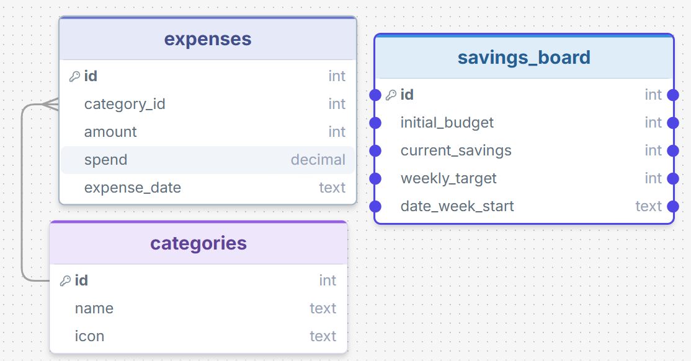
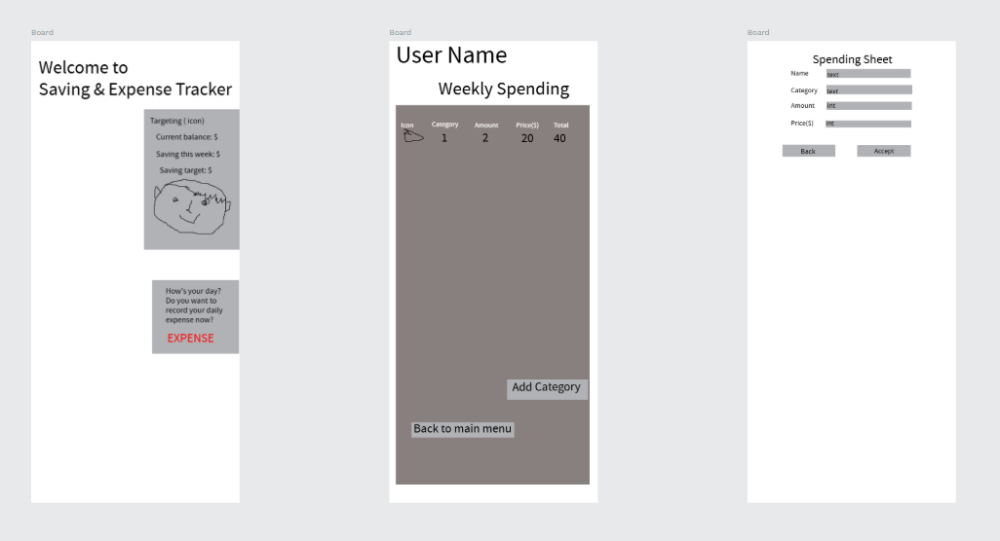
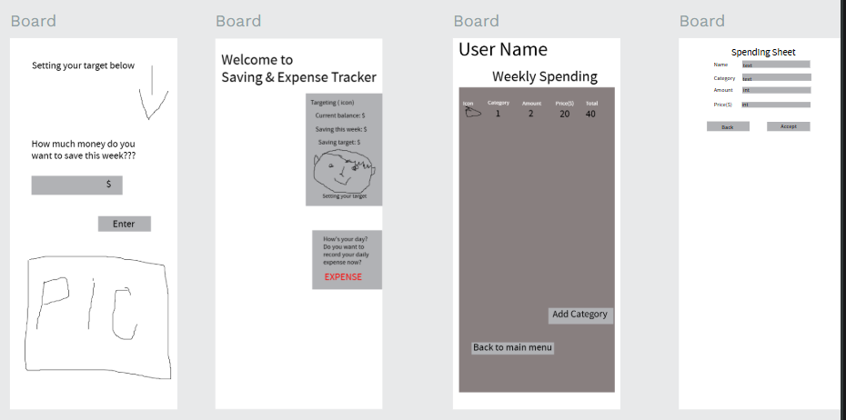

# Sprint 1 - Developing a DB and UI Prototype

## Sprint Goals
The database is designed to store user information, daily expenses, weekly savings goals, and weekly summaries while reducing duplicated data.

Develop a design for the database and a UI prototype that simulates the key functionality of the system. Test and refine the UI so that it can serve as the model for the next phase of development in Sprint 2.

### Specific Goals

**Edit these goals as needed**

- Design the database:
    - Tables
    - Fields / types
    - Primary keys
    - Default / nullable values
    - Relationships (foreign keys)
- Design the UI
    - Key pages
    - User interactions and 'flow'
    - Page layouts / features
    - Colour palette
    - Etc.

## Initial Database Design

Replace this text with notes regarding the DB design.

### Required Data Input

The user will enter:

What they spent money on.
The type/category of the expense.
The amount spent.
The date of the expense.
Their weekly savings target.
Their available or starting amount of money.

### Required Data Output

The system will display:

The user's total spending for the week.
The amount saved.
The user's weekly savings target.
Progress towards the savings target.
A warning when savings are close to or below the target.
A weekly summary at the end of the week.

### Required Data Processing

total cost = cost per item x amount

total weekly spending = sum of all expense cost within the selected week

money saved = initial balance - total spending

savings progress = (money saved/weekly savings target) x 100

## UI 'Flow'

The first stage of prototyping was to explore how the UI might 'flow' between states, based on the required functionality.

This PenPot demo shows the initial design for the UI 'flow':

You can acess the flow [here](https://design.penpot.app/#/view?file-id=3be9e5e1-190f-8090-8008-705aa457ca4e&page-id=3be9e5e1-190f-8090-8008-705aa457ca4f&section=interactions&index=0&share-id=c269caa0-e456-818c-8008-88de1439d378)

### Testing

The initial UI flow was tested by following the main user tasks step by step. The test focused on whether a user could understand where to start, add an expense, set a savings target, return to the home screen, and view their progress. Make sure it connected

### Changes / Improvements

-Making the Add Expense button easier to find.
-Reducing the number of steps required to record an expense.
-Making the savings target easier to access and edit.
-Adding clearer navigation between the home screen, expense screen, and weekly summary.
-Showing the user's savings progress on the main screen.

## Initial UI Prototype

The next stage of prototyping was to develop the layout for each screen of the UI.

This Figma demo shows the initial layout design for the UI:

This PenPot demo shows the initial design for the UI design:

You can acess the design [here](https://design.penpot.app/#/view?file-id=3be9e5e1-190f-8090-8008-705aa457ca4e&page-id=3be9e5e1-190f-8090-8008-705aa457ca4f&section=interactions&index=0&share-id=c269caa0-e456-818c-8008-88de1439d378)
### Testing

The initial UI prototype was reviewed by considering the main actions that users would perform.

The testing focused on the layout, clarity of input fields, button placement and navigation between pages.

The testing include:
    Open the home page, the dashboard should be displayed

    Select Expense Track, the expense list should open

    Select Add Expenses, the expense form should open

    Enter and save an expense, the new expense should be stored

    Select a date, expenses for that date should be displayed

    Select Delete, the selected expense should be removed

    Open Set Target, the target-setting form should open

    Save a weekly target, the target should be updated

    Return to Home, the dashboard should be displayed

### Changes / Improvements

Making the input fields more consistent across forms.

Improving the spacing between buttons and form elements.

Making important actions more noticeable.

Keeping the layout consistent across all pages.

Improving the visibility of expense information in the expense table.

Ensuring that users can easily return to the dashboard.

## Refined UI Prototype

Having established the layout of the UI screens, the prototype was refined visually, in terms of colour, fonts, etc.

This Figma demo shows the UI with refinements applied:

You can acess the refinements [here](https://design.penpot.app/#/view?file-id=3be9e5e1-190f-8090-8008-705aa457ca4e&page-id=3be9e5e1-190f-8090-8008-705aa457ca4f&section=interactions&index=0&share-id=c269caa0-e456-818c-8008-88de1439d378)### Testing

The refined interface was reviewed to check whether the visual changes improved readability and consistency.

This test focused on:
    Whether text was easy to read.

    Whether the colour contrast made important information noticeable.

    Whether buttons and links were easy to identify.

    Whether the different pages followed a consistent layout.

    Whether the interface remained understandable when displaying financial information.

### Changes / Improvements

The visual design was refined to create a more consistent experience across the application.

The main improvements included:

    Using a consistent colour palette throughout the pages.

    Improving the alignment of dashboard content.

    Using consistent borders and rounded corners.

    Making important links and buttons easier to recognise.

    Improving the organisation of information on the dashboard and forms.

## Sprint Review

Sprint 1 successfully established the foundation for the Savings and Expense Tracker by creating a database structure and developing a user-friendly UI prototype. The main pages and navigation were designed to support expense tracking and weekly savings goals.

However, some features, such as weekly summaries and savings progress calculations, still need further development.

Overall, this sprint provided a solid foundation for Sprint 2, where the focus will be on improving functionality and completing the savings features.
