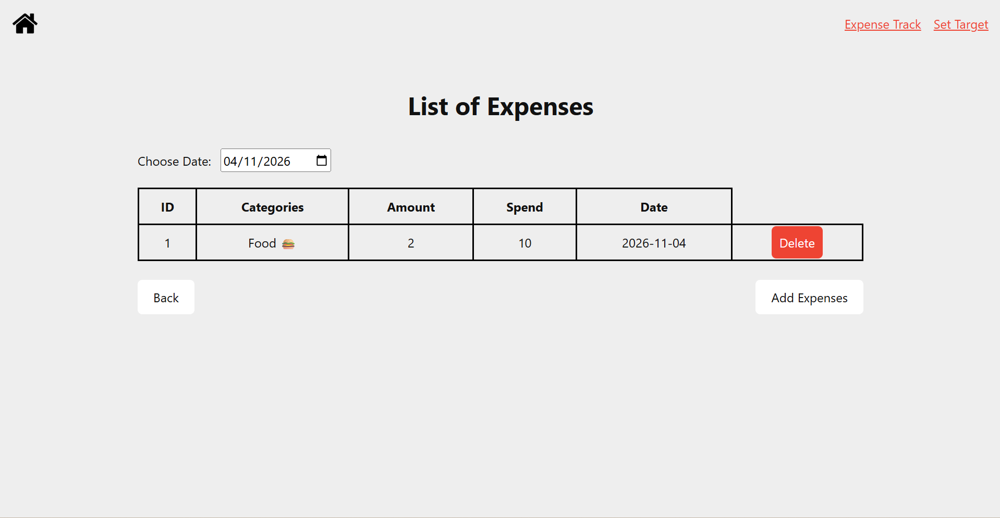

# Sprint 2 - Implement Database and Display of Test Data

## Sprint Goals

The goal of this sprint was to create the database for my Savings and Expense Tracker website, add test data and display the information on webpages.

### Specific Goals

**Edit these goals as needed**

    Create three database tables: savings, categories and expenses.

    Connect the expenses table to the categories table using a foreign key.

    Insert sample data into all three tables.

    Display savings information and weekly expenses on the homepage.

    Create an expense list page with a date filter.

    Create a form for users to add new expenses.

    Create a page where users can set their weekly savings target.

    Write SQL queries to retrieve, insert, update and delete records.

    Test the database connections, SQL queries and webpage displays.

## Testing Database Creation and Sample Data

I tested whether the three database tables were created correctly and whether the sample data was inserted successfully.

I checked the savings, categories and expenses tables to make sure that the records were stored correctly. I also checked the foreign key relationship between the expenses and categories tables.

The outcome:
    The three database tables were created.

    Sample savings information was inserted into the savings table.

    Sample categories, including Food and Movie, were inserted into the categories table.

    Sample expense records were inserted into the expenses table.

    The category_id field connects each expense to its category.

### Changes / Improvements

The database structure was created to organise savings, expense categories and expense records separately. A foreign key was added to connect expenses with their categories, making it possible to display the category name and icon with each expense.

## Testing Homepage and Savings Information

I tested the homepage to check whether the savings information from the database could be displayed on the website.

I checked whether the page displayed the current savings balance and weekly savings target. I also checked the weekly expense section.

The outcome:
    The homepage successfully retrieves savings records from the savings table.

    The current savings balance and weekly target are displayed using database values.

    The homepage layout includes a section for weekly expenses.

    The weekly expense total still need further testing and improvement because the required data is not fully passed to the homepage template.

### Changes / Improvements

I identified that the homepage route needs to pass the weekly expense information to the template. This will allow the weekly expense section to display complete and accurate information.

## Testing Expense List and Date Filter

I tested the expense list page to check whether expense records could be retrieved from the database and displayed correctly.

I also selected different dates to check whether the date filter showed only expenses recorded on the selected date.

The outcome:
    Expense records were retrieved from the expenses table.

    The SQL JOIN query connected the expenses table with the categories table.

    Category names and icons were displayed alongside the expense records.

    The date filter allowed users to view expenses from a selected date.

### Changes / Improvements

The SQL JOIN query made the expense list more informative by displaying category names and icons instead of only category IDs. The date filter also made it easier for users to find expenses from a specific day.

## Sprint Review

Sprint 2 successfully established the database and connected it to the main webpages. Sample data could be stored and displayed, and users could add expenses and update their weekly savings target.

However, some homepage calculations and data displays still need improvement. These will be continued in the next sprint.

Overall, Sprint 2 made the website more functional and provided a foundation for further development.

