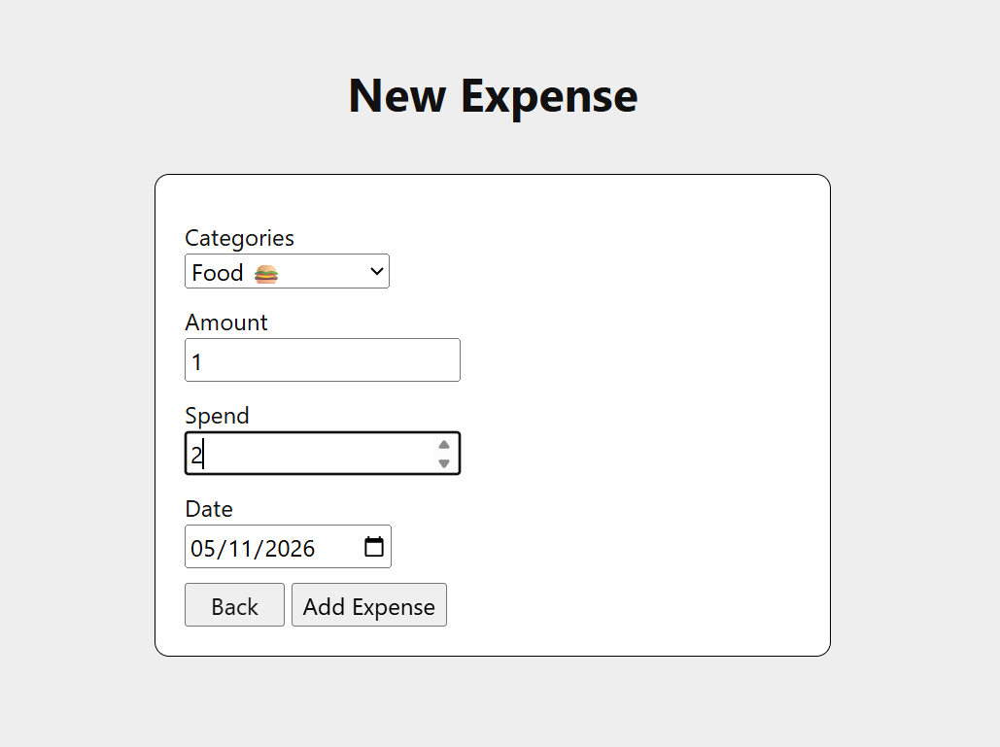
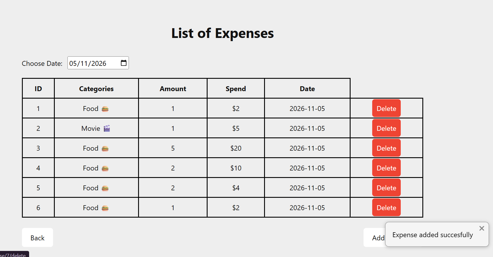
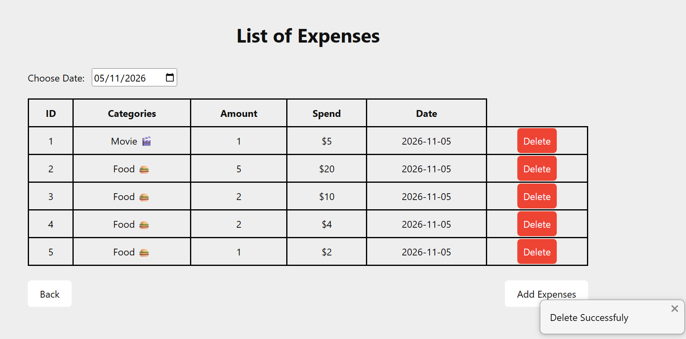
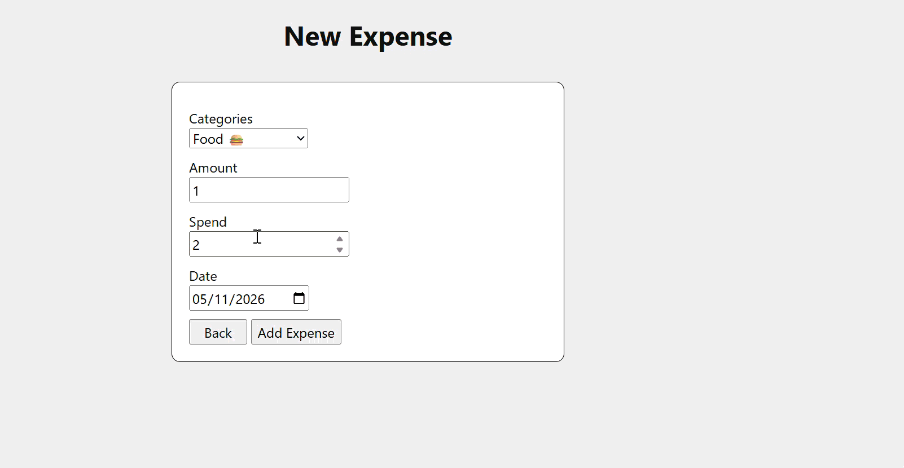
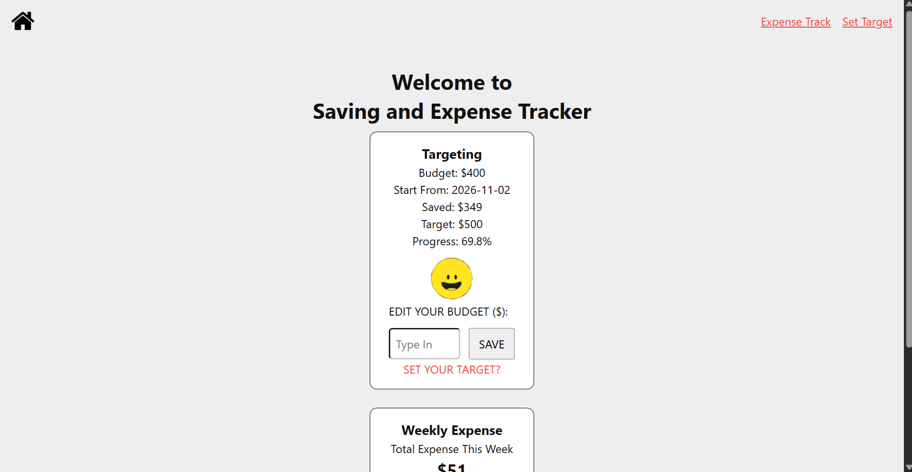
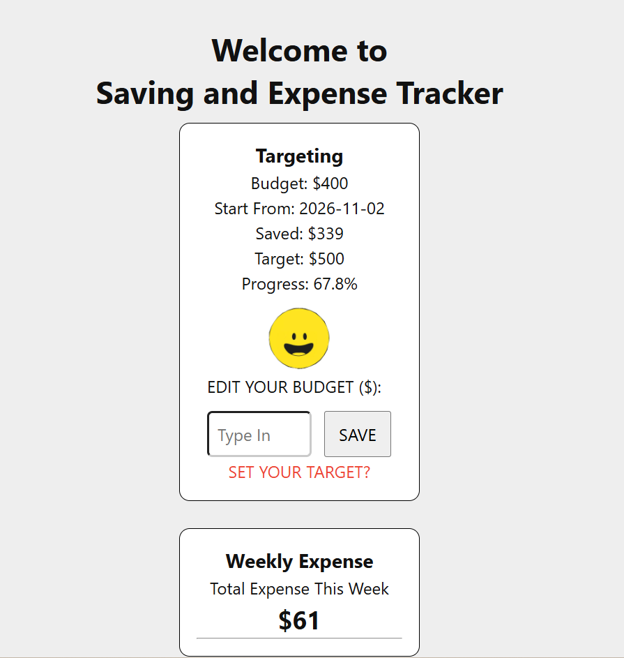
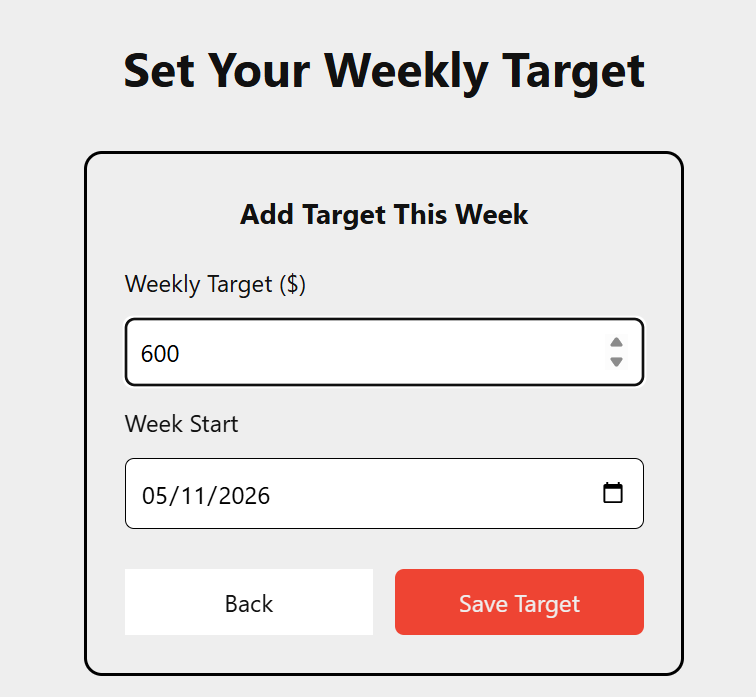
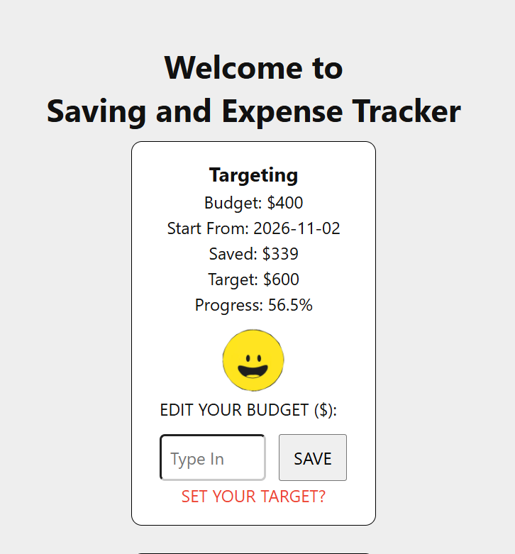

# Sprint 3 - Developing a Minimum Viable Product (MVP)

## Sprint Goals

Continue to develop the web application to the point that it provides all key functionality of the system. Test and refine it so that it can serve as the basis for the final phase of development.

### Specific Goals

**Edit these goals as needed**

- Complete the main webpages:

    Homepage to display savings information and weekly expense summaries.

    Expense list page to view and filter expense records.

    Add Expense form to record new expenses.

Weekly Target form to update savings goals.
- Develop SQL database queries to:
    Retrieve savings and expense information.

    Add new expense records.

    Update weekly savings targets.

    Delete existing expense records.

    Calculate total expenses for the current week.

    Identify the category with the highest spending.

## Testing Adding and Managin Expenses

I tested the expense management functions to check whether users could add new expenses and remove unwanted records.

I entered expense details, including the category, amount, spending value and date. I then checked whether the new record appeared in the expense list. I also tested the delete function.

The outcome:
    Users could select a category from the database.

    New expense records could be submitted and stored in the database.

    Added expenses could be displayed on the expense list page.

    The delete function could remove an expense record from the database.

### Changes / Improvements

The expense form and database operations were connected to allow users to manage their daily spending. Further improvements could include adding validating that the spending amount is greater than zero.
**PLACE SCREENSHOTS AND/OR ANIMATED GIFS OF THE IMPROVED SYSTEM HERE**

## Testing Weekly Expense Summary

I tested the homepage to check whether it could calculate and display the total expenses for the current week.

I used sample expense records with different dates and spending amounts to check whether only expenses within the current week were included in the calculation.

The outcome:
A SQL query was created to calculate the total spending between the start and end dates of the current week.

The homepage layout included a section for total weekly expenses.

The homepage still needed improvements to pass the calculated results to the template and display the summary correctly.

### Changes / Improvements

The weekly expense calculation and category summary needed to be completed in the homepage route. The calculated results should be passed to the template so that users can clearly understand their spending habits.

## Testing Updating Weekly Savings Target

I tested the weekly target form to check whether users could enter a new savings target and select the starting date of the week.

After submitting the form, I checked the database and homepage to see whether the updated information was saved and displayed correctly.

The outcome:
    Users could enter a weekly savings target.

    Users could select the starting date of the week.

    The submitted target was used to update the savings record in the database.

    The homepage could retrieve the updated target information.

### Changes / Improvements

The weekly target form was connected to the database using an UPDATE query. Input validation could be improved to prevent negative values or invalid dates.

## Sprint Review

Sprint 3 developed the website into a more functional MVP. Users could add and delete expenses, view expense records and update their weekly savings target.

However, the weekly expense summary and input validation still needed further improvement. These improvements would be important for the final development stage.

Overall, this sprint connected the main features into a working system and provided a foundation for final testing and refinement.
