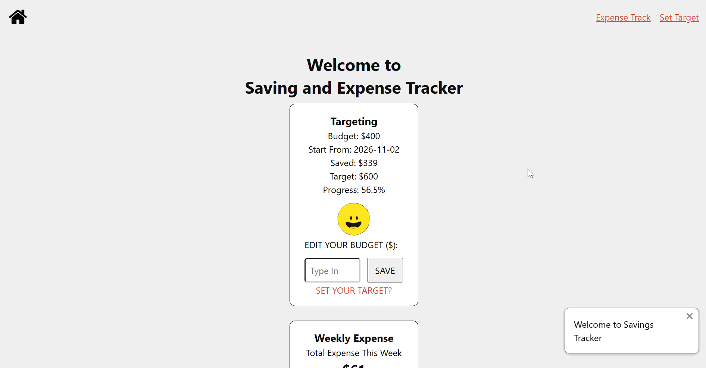
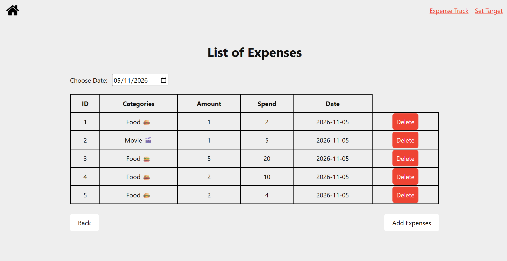
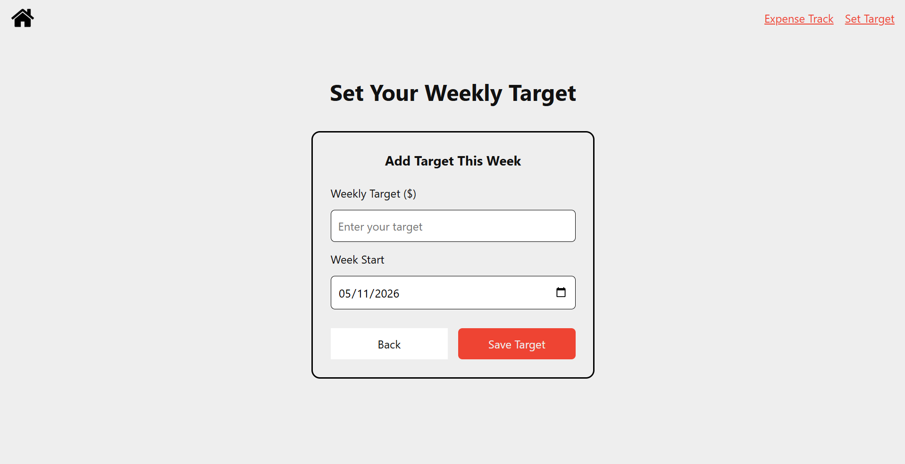
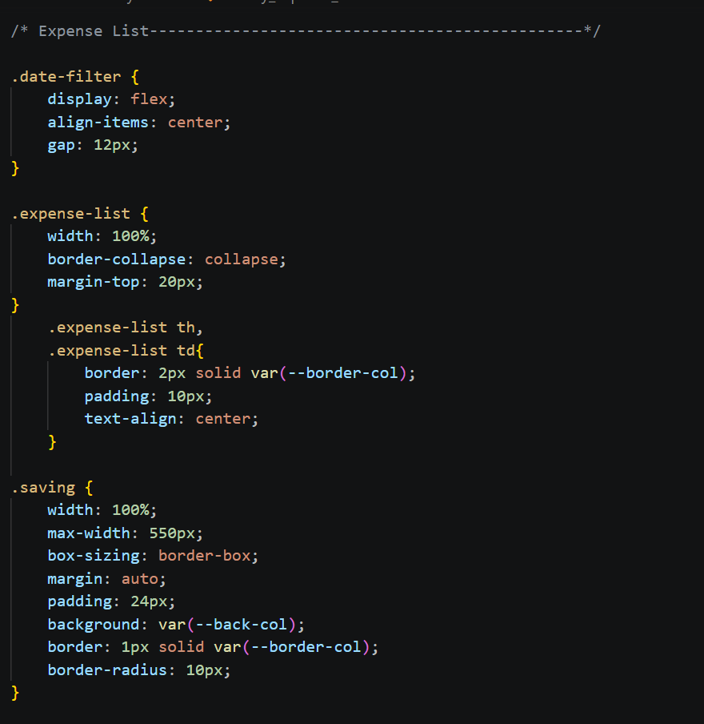
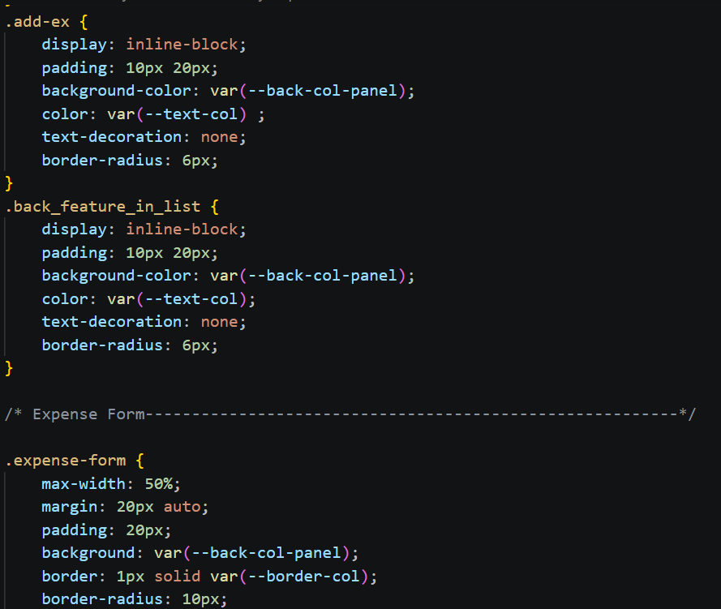
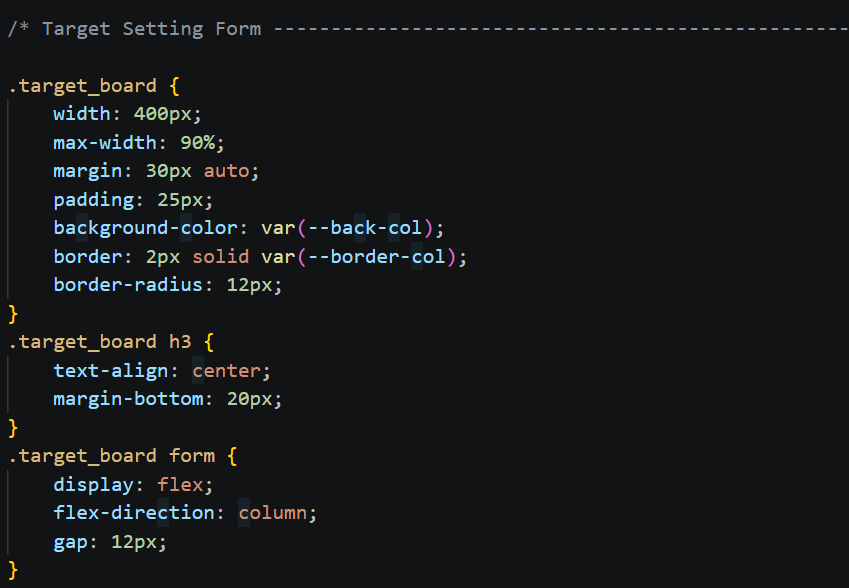
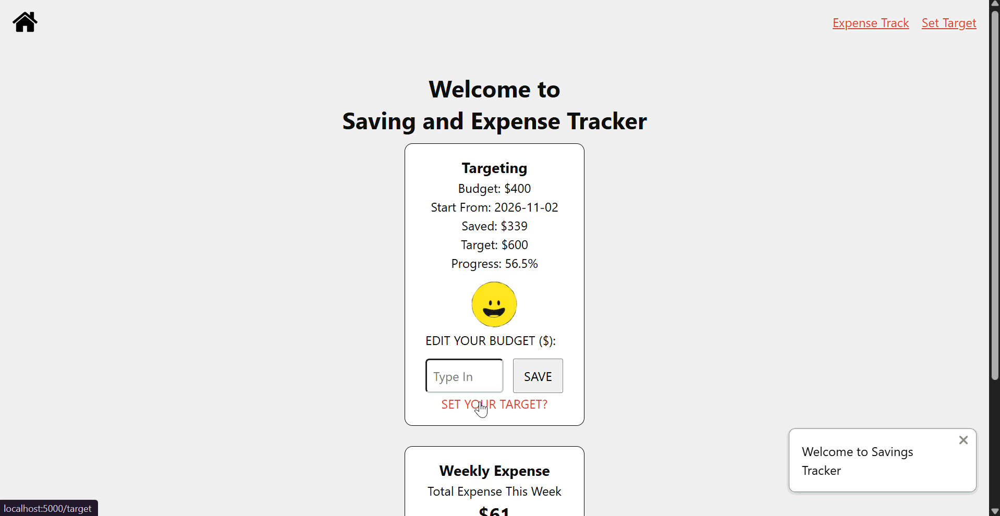
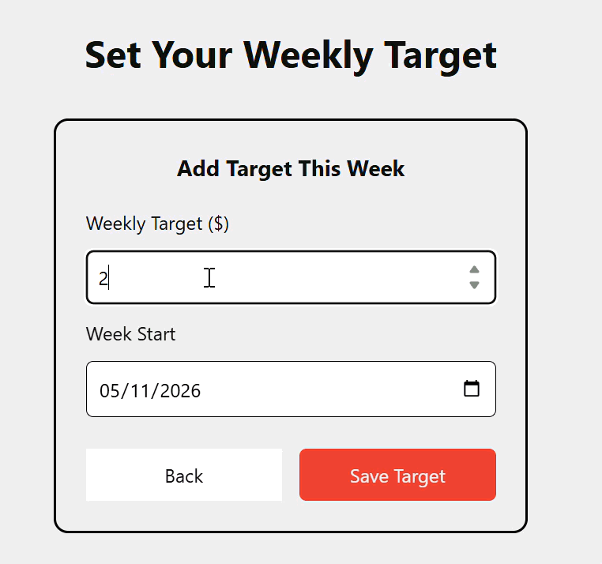

# Sprint 4 - Developing a Refined and Complete System

## Sprint Goals

Develop the system until it is fully featured, with a refined UI and it satisfies the requirements. The system will be fully tested at this point.

### Specific Goals

    Refine the website layout, colours, fonts and overall design.

    Improve the user experience and navigation between webpages.

    Make sure all forms are clear and easy to use.

    Check that all information is displayed correctly.

    Fix any errors or issues found during testing.

    Perform final testing of all main features.

## Testing Final User Interface (UI) and Layout

I tested the overall appearance of the website, including the homepage, expense list, add expense form and weekly target page.

I checked the alignment, spacing, colours, font sizes and consistency of the design across all pages.

The outcome:
    The main webpages followed a consistent design.

    The colour scheme and layout were used throughout the website.

    The main information and buttons were visible.

    Some layout and spacing adjustments were needed to improve the appearance of the pages.

### Changes / Improvements

I refined the layout by adjusting spacing, alignment and element sizes. I also made the design more consistent across the webpages to create a cleaner and more organised appearance.

**PLACE SCREENSHOTS AND/OR ANIMATED GIFS OF THE IMPROVED SYSTEM HERE**
.png)
.png)

.png)

## Testing User Experience and Navigation

I tested the navigation between the main webpages to check whether users could easily access the different features.

I followed the main user journey, starting from the homepage, opening the expense list, adding a new expense and returning to the homepage.

The outcome:
    Users could access the main features through navigation links.

    The buttons and links directed users to the correct pages.

    The page structure allowed users to complete the main tasks.

    Some buttons and navigation elements needed clearer labels and positioning.

### Changes / Improvements

I improved the placement and appearance of buttons and navigation links. I also made button labels clearer so users could understand the purpose of each action more easily.

## Testing Form Validation and Error Handling

I tested the Add Expense form and Weekly Target form by entering different types of information, including valid and invalid inputs.

I checked whether required fields were completed and whether the forms prevented users from submitting missing or incorrect information.

The outcome:
    Required fields helped prevent incomplete submissions.

    Number and date input fields provided basic input restrictions.

    Further validation was needed to handle incorrect values and unexpected user input.

### Changes / Improvements

I improved the forms by making input fields clearer and checking that required information was provided. Additional validation could be used to prevent negative spending amounts and invalid savings targets.

## Sprint Review

Sprint 4 focused on refining the website design, improving navigation and performing final system testing.

The main features were brought together into a more complete and user-friendly system. Some issues identified during testing required further adjustments.

Overall, this sprint helped prepare the Savings and Expense Tracker for final submission.
